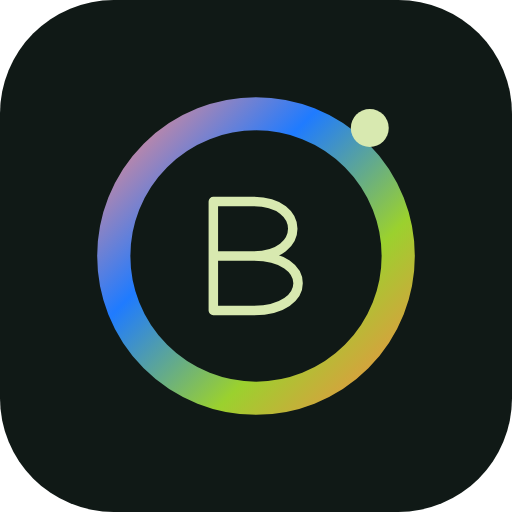
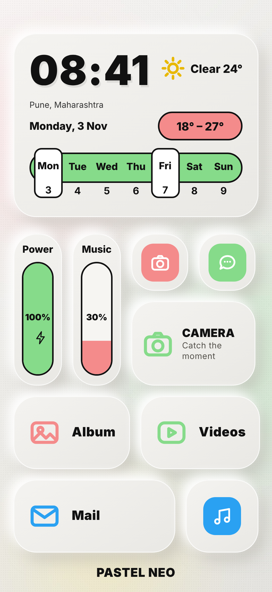
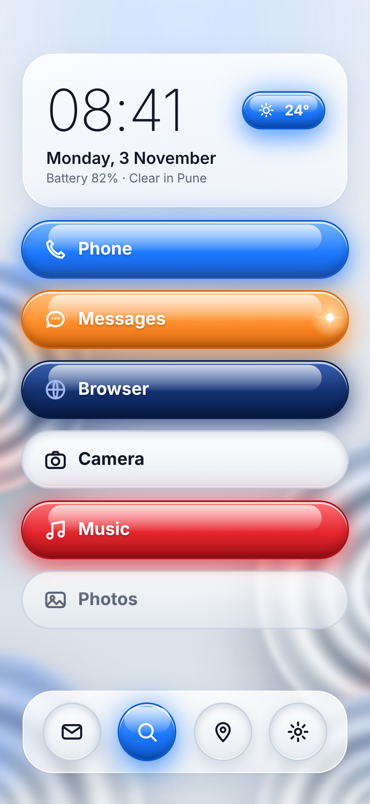
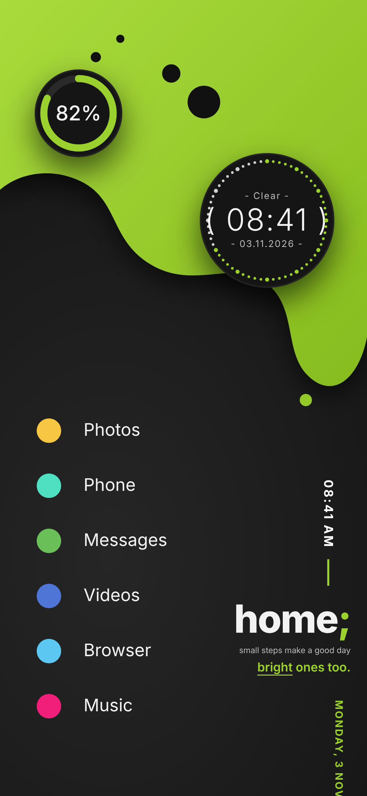
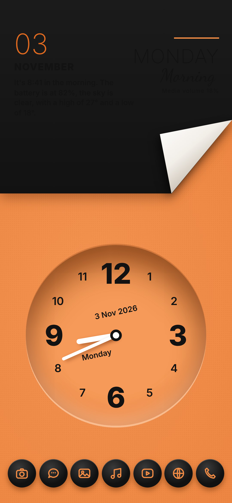
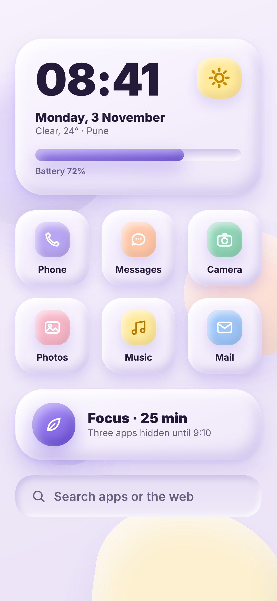
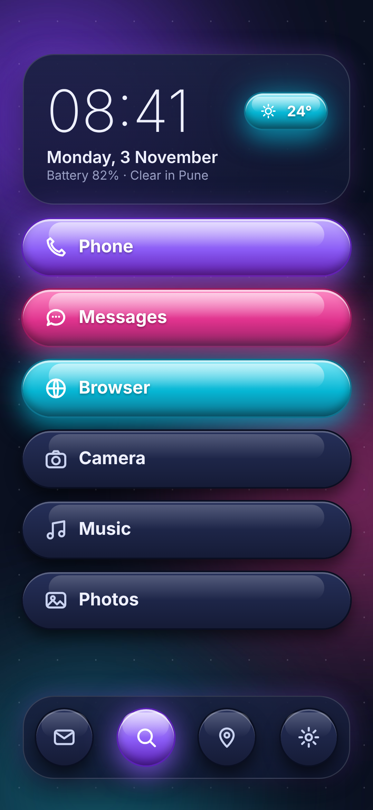
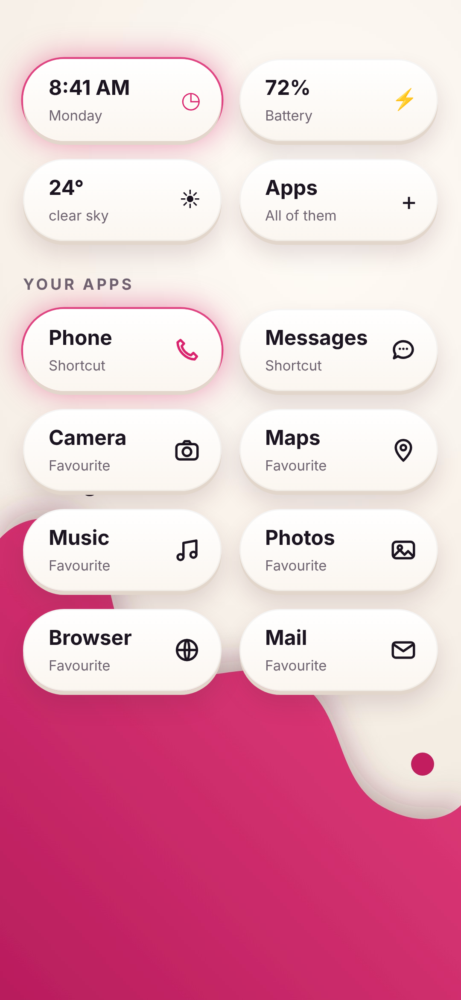
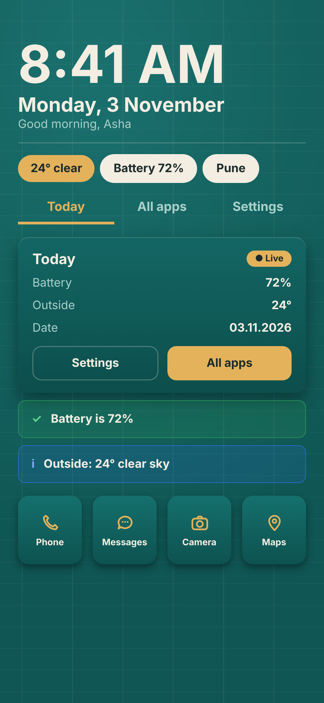
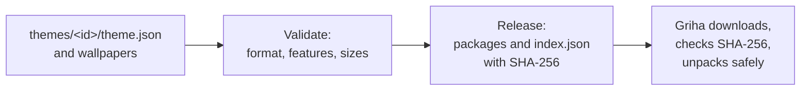

<h1 align="center">
   
  
   
  Griha Themes
   
</h1>

<h4 align="center">Downloadable themes for Griha, the calm Android home screen: colours, depth, light, wallpapers and widgets as small data packages.</h4>

  
  
  
  

  <a href="#-the-themes">The themes</a> •
  <a href="#-get-started">Get started</a> •
  <a href="#-how-it-works">How it works</a> •
  <a href="#-faq-and-troubleshooting">FAQ</a> •
  <a href="#%EF%B8%8F-for-theme-makers">For theme makers</a>

  
  
  
  

  
  
  
  

This is the theme catalogue for [Griha](https://github.com/sudharamachandranrajeev/griha-home-launcher).
A theme here is **data only**: colours, how surfaces are lit, page backgrounds, wallpapers and widget styles.
It holds no code, so it cannot do anything on your phone except change how Griha looks.
Status: **early**. Griha 0.6 draws each theme's colours, surfaces, page, touch light and its own home layout.

## 🎨 The themes

| Theme | Look | Elements |
| --- | --- | --- |
| **Pastel Neo** | Soft grey neumorphism: a chunky clock card with a week pill, tall Power and Music meters, wide app cards, bold outlines | [elements](themes/pastel-neo/elements.png) |
| **Candy Gloss** | A frosted clock over chrome dials, then glossy jelly pills that change colour by state, and a jelly dock | [elements](themes/candy-gloss/elements.png) |
| **Lime Blob** | Charcoal with a lime blob: a battery ring, a dotted clock ring, a dot list of apps and a sideways motto | [elements](themes/lime-blob/elements.png) |
| **Tangerine Peel** | Orange under a peeling cream panel: an info panel, a deep well clock and black badge icons | [elements](themes/tangerine-peel/elements.png) |
| **Clay Bloom** | Puffy clay cards after the soft system board: clock, profile, battery and note cards, tiles and a bottom bar | [elements](themes/clay-bloom/elements.png) |
| **Midnight Jelly** | A dark dashboard after the neo-skeuomorphic board: segmented tabs, stat cards, a chevron list, toasts and glowing steps | [elements](themes/midnight-jelly/elements.png) |
| **Berry Wave** | Tactile pill keys for everything, time and battery included, over a berry wave | [elements](themes/berry-wave/elements.png) |
| **Teal Grid** | A teal product styleguide: headline time, chips, underline tabs, a status card, alert banners and tiles | [elements](themes/teal-grid/elements.png) |

Each theme brings its own home layout as well as its colours; Griha 0.6 builds it from the theme's `home` blocks.

## 🚀 Get started

**Use the wallpapers now.**

1. Open the [latest catalogue release](https://github.com/sudharamachandranrajeev/griha-launcher-themes/releases/latest) on your phone.
2. Download `<theme>-wallpapers.zip`.
3. In Griha, open **Settings → Look and theme → Wallpapers → Import pictures or ZIP** and pick the file.
4. Tap the new wallpaper and choose **Griha: home and all apps**.

**Use whole themes** (from Griha 0.6): **Settings → Look and theme → Themes → Get more themes**. Griha lists
each theme with its preview; download it, use it, or remove it there.

## 🧭 How it works

- **The engine and features.** [`engine/features.json`](engine/features.json) lists what each Griha theme engine can
  draw. A theme names the features it `requires` and the ones it `prefers`. The catalogue only offers a theme once a
  released engine has everything it requires, so Griha never shows a theme it would draw wrong.
- **Safety.** Griha accepts a theme only if its SHA-256 matches the catalogue. Archives are unpacked with every path
  checked to stay inside the theme's own folder. Pictures and the package as a whole are size-capped.
- **Space.** Each downloaded theme lives in its own folder and can be deleted. Built-in themes are part of Griha and can
  be hidden; they are drawn by code and take very little space.

## ❓ FAQ and troubleshooting

A theme says "Needs a newer Griha"

It uses something your Griha cannot draw yet. Update Griha in **Settings → Updates and versions**.

Can a theme read my data or run code?

No. A theme is a JSON file plus pictures and fonts. Griha reads it as settings; nothing in it runs.

## 🛠️ For theme makers

Make or change a theme

1. Copy a folder in `themes/` and rename it; the folder name is the theme's `id`.
2. Edit `theme.json`. [`schema/theme.schema.json`](schema/theme.schema.json) describes every field.
   Colours are `#RRGGBB`, `#AARRGGBB` or a palette name with an opacity, such as `accent@0.4`.
   Shadows are `[x, y, blur, colour, spread]` in dp.
3. Artwork is made from HTML in `themes/<id>/art/`; each file names its output in a `<meta name="out">` tag.
   Re-render it with Playwright: `npm i -D playwright && npx playwright install chromium && node tools/render.mjs`.
4. Check it: `pip install jsonschema && python3 tools/validate.py`.
5. Open a pull request. The **Validate** workflow runs the same checks.

A new kind of effect needs Griha first: add the feature to Griha's theme engine, release Griha, add the feature to
`engine/features.json` here, then publish the theme.

Publish the catalogue

Run **Actions → Release → Run workflow** on `main`. It validates, packs every theme and its wallpaper pack, writes
`index.json` with SHA-256 checksums and attaches them to a new release named `themes-<date>-<run>`.

## Related

| App | What it does |
| --- | --- |
| [griha-home-launcher](https://github.com/sudharamachandranrajeev/griha-home-launcher) | The home screen these themes are for |
| [brahma](https://github.com/sudharamachandranrajeev/brahma-life-suite) | The shared core and the all-in-one app |

## License

[MIT](LICENSE). Icons in the artwork are original drawings, not app logos.
Dancing Script, used in Tangerine Peel's artwork, is under the SIL Open Font License (`tools/art/fonts/DancingScript-OFL.txt`).

---

> GitHub [@sudharamachandranrajeev](https://github.com/sudharamachandranrajeev)
